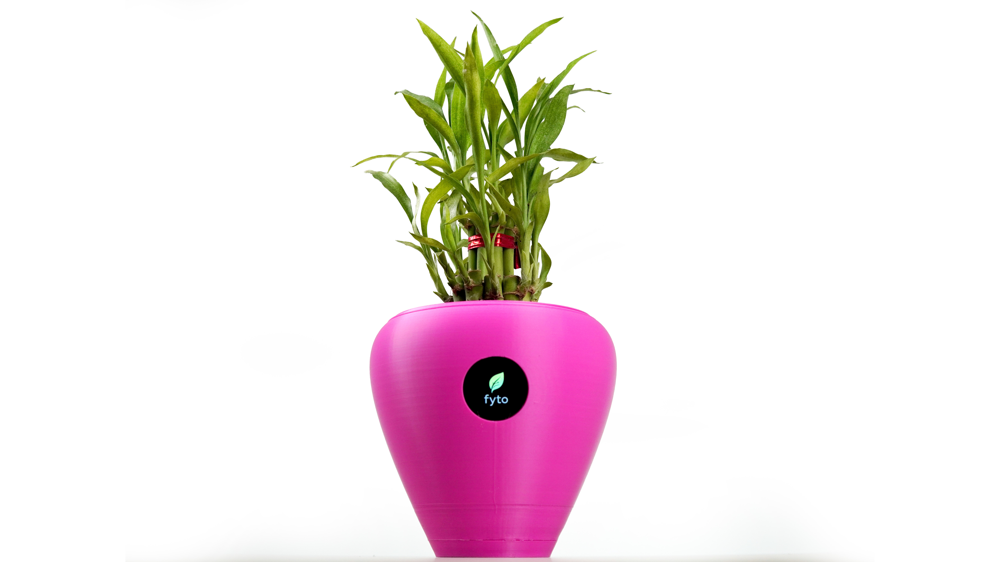
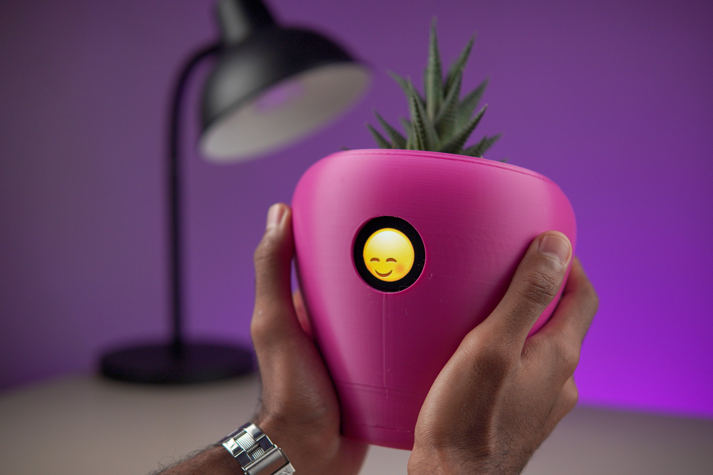

# Project Basics

**Project name:** Fytó

**Project teaser:** An expressive, ESP32-S3-based smart planter that turns your houseplant into a pet

---

# Introduce Your Project

**Your plant has always had feelings. Now it has a face.**

**Fytó** by CodersCafe is a smart planter with six senses and a round display that shows how your plant feels, in real time.

Dry soil? Fytó looks parched. Too warm? It looks flushed. Not enough light? It yawns. Water it, and watch the relief spread across its face.

**Touch it, and it loves you back.** Hearts, wide eyes, pure joy. That small moment of feedback is what turns a plant into a pet.

**Feedback that lives on the pot, not in an app.** Most smart plant monitors hide their readings behind a phone notification. Fytó puts them right where you'll see them, on a face that sits on your desk or windowsill.

**Open source and lock-in free.** Fytó works on its own out of the box. When you want more, it connects to Home Assistant, Blynk, Arduino IoT Cloud, MQTT, or a dashboard you host yourself.

---

# Applications

## A Plant That Talks Back

**Plants go quiet until it's too late.** By the time a leaf droops or yellows, the damage is done. Fytó makes those signals impossible to miss. A thirsty face on your desk is much harder to ignore than a reminder buried in an app.

**Every face is driven by real sensor data.** Soil moisture, temperature, humidity, light, and water level map directly to an emotion, so you learn what your plant actually needs. Up to ten plant profiles let you tune Fytó for a succulent, a fern, or anything in between.

**Built for tinkerers, too.** Feed Fytó's readings into Home Assistant automations, a Blynk or Arduino IoT Cloud dashboard, or your own MQTT tools. Add sensors, write new expressions, or print a completely new enclosure.

**Born in the maker community.** The original Fytó, built on a Raspberry Pi Zero 2 W, was shared on [YouTube](https://youtu.be/zNNZdUzXV7M), [Hackster.io](https://www.hackster.io/coderscafe/fyto-turn-your-plant-into-pet-1373d5), [Instructables](https://www.instructables.com/Fyt%C3%B3-Turn-Your-Plant-Into-Pet), and [Hackaday.io](https://hackaday.io/project/186729-fyt-turn-your-plant-into-pet), and rebuilt by makers around the world. This version is what we learned from them: more senses, a round face, a proper PCB, and no breadboard required.

---

# Features & Specifications

### Core Hardware
- **Microcontroller:** ESP32-S3, dual-core Xtensa LX7 @ 240 MHz, 8 MB PSRAM
- **Connectivity:** 2.4 GHz Wi-Fi (802.11 b/g/n)
- **Display:** 1.28" round IPS, 240 x 240 pixels, GC9A01 controller
- **Ports:** USB Type-C for power and programming
- **Power:** 5 V via USB Type-C (no internal battery)
- **Sensor connections:** Keyed JST connectors; no soldering required

### Sensors
- **Soil moisture:** Capacitive, TLC555-based (no exposed metal probes, resistant to corrosion)
- **Temperature & humidity:** AHT20 (±0.3 °C, ±2% RH typical)
- **Ambient light:** LDR photoresistor, also used for automatic display brightness
- **Water level:** Conductivity probe for reservoir detection
- **Touch:** TTP223 capacitive touch sensor, with support for the ESP32-S3's native touch pins

### Personality
- Six emotions: Happy, Thirsty, Hot, Freeze, Sleepy, and Pampered
- Full-color animated expressions at 240 x 240
- Priority system that shows the most important need first:
  1. Dry soil → Thirsty
  2. Too warm → Hot
  3. Too cold → Freeze
  4. Too dark → Sleepy
  5. All needs met → Happy
- Touch overrides every other state with a randomized Pampered animation
- Configurable transitions between emotions: instant, fade, slide, or dissolve

### Firmware
- FreeRTOS-based firmware with concurrent display, sensor, touch, state, menu, and MQTT tasks
- Boots in under one second
- Configuration through a serial menu, accessible from any serial terminal or directly in Chrome or Edge via WebSerial
- Up to 10 plant profiles with individual moisture, temperature, light, and water-level thresholds
- Two-point calibration for soil moisture and light, stored in flash and retained across firmware updates
- Adjustable animation duration, priority mode, boot screen, and auto-brightness range

### Integrations
- Works standalone with no Wi-Fi or account required
- Home Assistant
- Blynk (dedicated firmware build)
- Arduino IoT Cloud (dedicated firmware build)
- MQTT (disabled by default) with per-device topics for sensor data, status, and mood
- Self-hostable Fytó dashboard with real-time gauges, mood timeline, sensor history charts, alerts, and multi-plant support

### Physical
- **Dimensions (H x W x D):** 15 x 16 x 16 cm (5.9 x 6.3 x 6.3 in)
- **Weight (empty):** 200 g (7.1 oz)
- **Enclosure:** 3D printed

---

# Open Source

**Everything will be open.** The files for the original Raspberry Pi Zero 2 W version of Fytó are already public on [GitHub](https://github.com/CodersCafeTech/Fyto). For this ESP32-S3 version, we will publish the firmware, schematics, PCB layout, bill of materials, enclosure 3D files, and self-hosted dashboard following a successful campaign, before units ship to Crowd Supply for fulfillment.

- **Hardware (schematics, PCB layout, BOM):** CERN-OHL-S-2.0
- **Firmware:** GPL-3.0
- **Dashboard:** AGPL-3.0
- **Enclosure 3D files & documentation:** CC BY-SA 4.0

Once the files are public, anyone can open issues, submit pull requests, design new enclosures, add sensors, or create new expressions. We will highlight the best community remixes.

The Fytó name and logo are trademarks of CodersCafe and are not covered by the licenses above.
