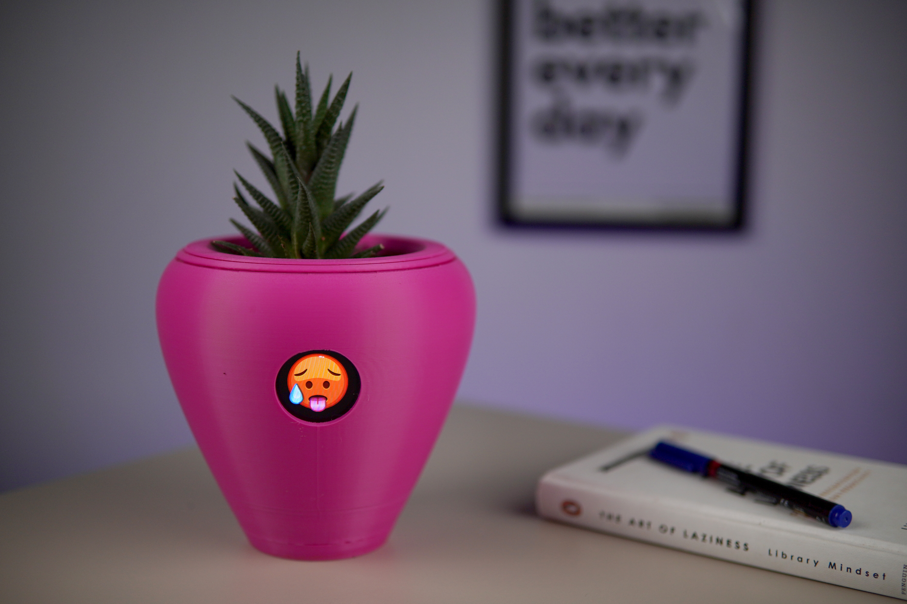
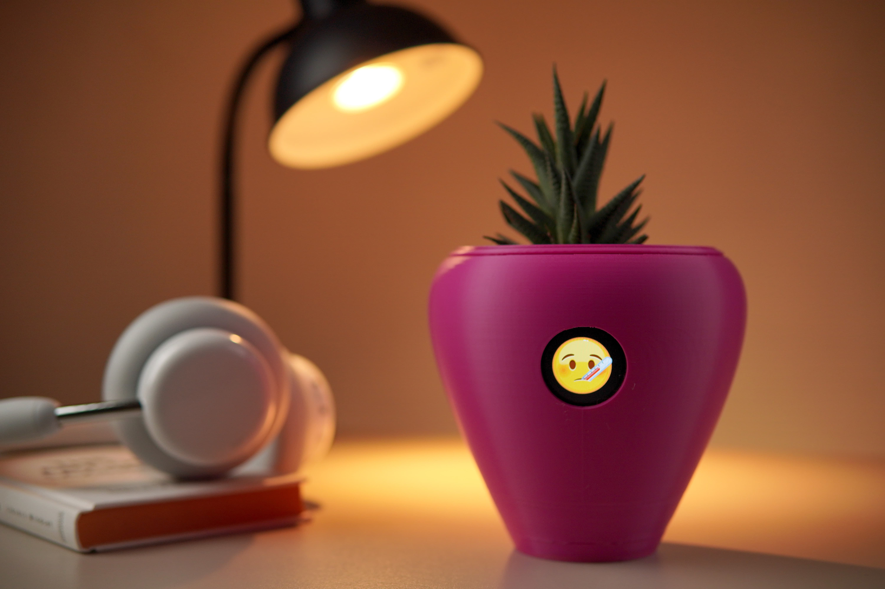
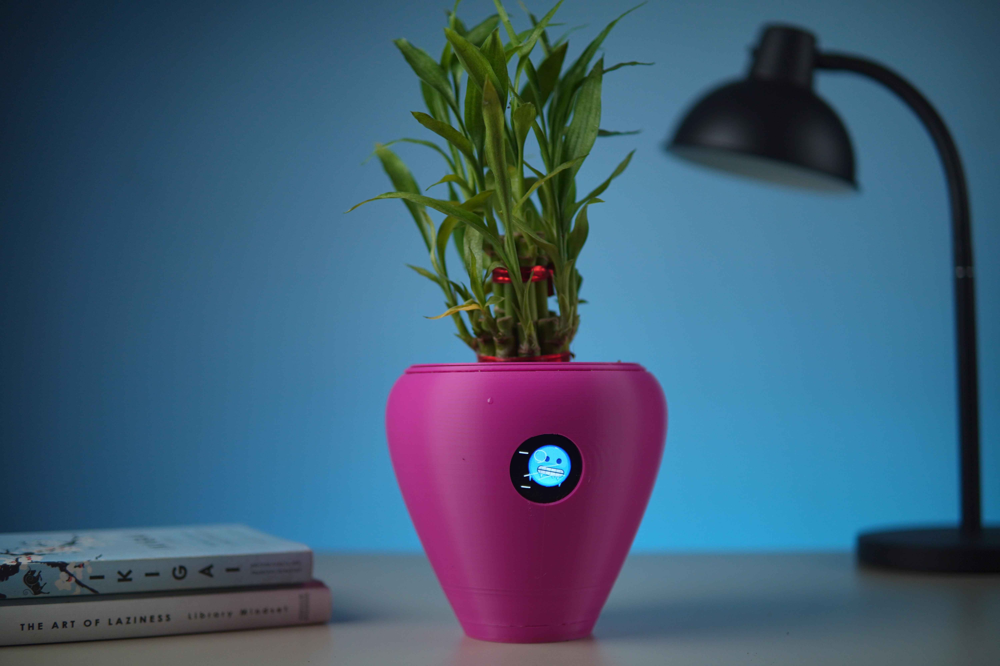
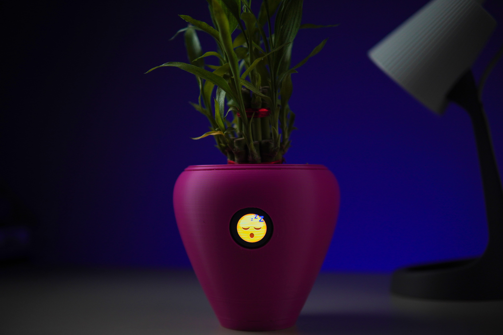
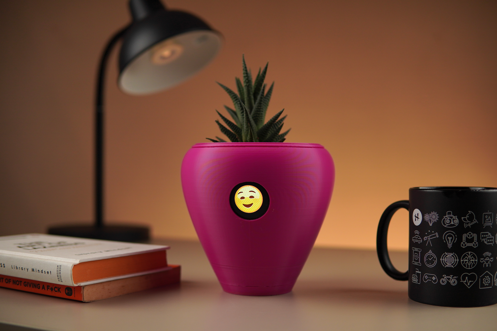

# Project Basics

**Project name:** Fytó

**Project teaser:** An open source, ESP32-S3-based smart planter that gives your houseplant a face

---

# Introduce Your Project

**Your plant has always had feelings. Now it has a face.**

**Fytó** is a smart planter with a round display, five senses, and a personality. It reads the soil, the air, the light, and your touch, and turns all of it into something anyone can understand at a glance: a face.

**Dry soil?** Fytó looks parched.

**Too warm?** It looks flushed.

**Too cold?** Its teeth start chattering.

**Too dark?** It drifts off to sleep.

**Water it**, and watch the relief spread across its face.

**Touch it, and it loves you back.** Hearts, wide eyes, pure joy. That small moment is what turns a plant into a pet.

**No app. No account. No subscription.** Plug Fytó in and it starts caring for your plant. When you want the numbers behind the face, the **Fytó Dashboard** puts every plant in your home on one screen, with live gauges, history charts, a timeline of moods, and alerts, all running on your own hardware.

**Open source, inside and out.** Firmware, hardware, enclosure, and dashboard are all open. Fytó doesn't depend on our servers, so it keeps working no matter what happens to us.

---

# Applications

## A Plant That Talks Back

**Plants go quiet until it's too late.** By the time a leaf droops or yellows, the damage is done. Fytó makes those signals impossible to miss. A thirsty face on your desk is much harder to ignore than a reminder buried in an app.

**Every face is driven by real sensor data.** Soil moisture, temperature, humidity, and light map directly to an emotion, so over time you learn what your plant actually needs. Up to ten plant profiles let you tune Fytó for a succulent, a fern, or anything in between.

## The Fytó Dashboard

The face tells you how your plant feels right now. The dashboard tells you its story. See live readings on real-time gauges, scroll back through sensor history to spot the afternoon your windowsill gets too hot, and follow a mood timeline that shows how your plant's week really went. Set alerts so you hear about a dry pot before Fytó starts sulking.

Have more than one Fytó? The dashboard shows them all side by side. It's self-hosted, so your data stays on your network, and it's open source, so you can change any part of it.

## Built for Tinkerers

Fytó plays well with the tools you already use. Feed its readings into Home Assistant automations, a Blynk or Arduino IoT Cloud project, or your own MQTT setup. Add sensors, design new expressions, or print a completely new enclosure. Everything about Fytó is meant to be opened up and changed.

## From Our Workbench to Yours

We're CodersCafe, and Fytó started as a simple question: what if a plant could tell you how it feels? The first version ran on a Raspberry Pi Zero 2 W with a breadboard full of wires. We shared it on [YouTube](https://youtu.be/zNNZdUzXV7M), [Hackster.io](https://www.hackster.io/coderscafe/fyto-turn-your-plant-into-pet-1373d5), [Instructables](https://www.instructables.com/Fyt%C3%B3-Turn-Your-Plant-Into-Pet), and [Hackaday.io](https://hackaday.io/project/186729-fyt-turn-your-plant-into-pet), and makers around the world built their own.

Their builds and feedback shaped everything about this version: more senses, a round face, a proper PCB, a dashboard, and no breadboard or soldering required. This is the Fytó we always wanted to make, and now we want to put one on your desk.

---

# Features & Specifications

### Core Hardware
- **Microcontroller:** ESP32-S3, dual-core Xtensa LX7 @ 240 MHz, 8 MB PSRAM
- **Connectivity:** 2.4 GHz Wi-Fi (802.11 b/g/n)
- **Display:** 1.28" round IPS, 240 x 240 pixels, GC9A01 controller
- **Ports:** USB Type-C for power and programming
- **Power:** 5 V via USB Type-C (no internal battery)
- **Sensor connections:** Keyed JST connectors; no soldering required

### Sensors
- **Soil moisture:** Capacitive, TLC555-based (no exposed metal probes, resistant to corrosion)
- **Temperature & humidity:** AHT20 (±0.3 °C, ±2% RH typical)
- **Ambient light:** LDR photoresistor, also used for automatic display brightness
- **Touch:** TTP223 capacitive touch sensor, with support for the ESP32-S3's native touch pins

### Personality
- Six emotions: Happy, Thirsty, Hot, Freeze, Sleepy, and Pampered
- Full-color animated expressions at 240 x 240
- Priority system that shows the most important need first:
  1. Dry soil → Thirsty
  2. Too warm → Hot
  3. Too cold → Freeze
  4. Too dark → Sleepy
  5. All needs met → Happy
- Touch overrides every other state with a randomized Pampered animation
- Configurable transitions between emotions: instant, fade, slide, or dissolve

### Firmware
- FreeRTOS-based firmware with concurrent display, sensor, touch, state, menu, and MQTT tasks
- Boots in under one second
- Configuration through a serial menu, accessible from any serial terminal or directly in Chrome or Edge via WebSerial
- Up to 10 plant profiles with individual moisture, temperature, and light thresholds
- Two-point calibration for soil moisture and light, stored in flash and retained across firmware updates
- Adjustable animation duration, priority mode, boot screen, and auto-brightness range

### Integrations
- Works standalone with no Wi-Fi or account required
- Home Assistant
- Blynk (dedicated firmware build)
- Arduino IoT Cloud (dedicated firmware build)
- MQTT with per-device topics for sensor data, status, and mood
- Self-hostable Fytó dashboard with real-time gauges, mood timeline, sensor history charts, alerts, and multi-plant support

### Physical
- **Dimensions (H x W x D):** 15 x 16 x 16 cm (5.9 x 6.3 x 6.3 in)
- **Weight (empty):** 200 g (7.1 oz)
- **Enclosure:** 3D printed

---

# Open Source

**Everything will be open.** The files for the original Raspberry Pi Zero 2 W version of Fytó are already public on [GitHub](https://github.com/CodersCafeTech/Fyto). For this ESP32-S3 version, we will publish the firmware, schematics, PCB layout, bill of materials, enclosure 3D files, and self-hosted dashboard following a successful campaign, before units ship to Crowd Supply for fulfillment. All of it will be released under open source licenses.

Once the files are public, anyone can open issues, submit pull requests, design new enclosures, add sensors, or create new expressions. We will highlight the best community remixes.
